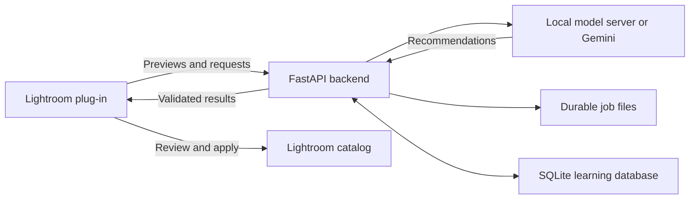

# AutoDevelop AI

AutoDevelop AI analyzes photos and recommends edits in **Adobe Lightroom
Classic**. A Lightroom plug-in sends JPEG previews to a Python backend, which
requests recommendations from a vision-capable AI model and validates them
before Lightroom can apply them.

The usual setup runs Lightroom, the backend, and LM Studio on one Windows
computer. Lightroom can also connect from another trusted computer.

**Experimental, version 0.1.x:** back up your catalog and start with test photos.

## Contents

- [Requirements](#requirements)
- [Architecture and design](#architecture-and-design)
- [Compatibility](#compatibility)
- [Setup](#setup)
- [First analysis and edit](#first-analysis-and-edit)
- [Commands and settings](#commands-and-settings)
- [Styles and editing features](#styles-and-editing-features)
- [Personalized learning](#personalized-learning)
- [Updating an installation](#updating-an-installation)
- [Job recovery and troubleshooting](#job-recovery-and-troubleshooting)
- [Storage and privacy](#storage-and-privacy)
- [Using two computers](#using-two-computers)
- [Development and license](#development-and-license)

## Requirements

| Component | Requirement |
|---|---|
| Lightroom | Adobe Lightroom Classic, installed and licensed separately |
| Python | Python 3.12 and the Windows Python launcher (`py`) |
| Git | Git to clone the repository |
| Inference server | LM Studio or an OpenAI-compatible server |
| Model | An image-capable model loaded in that server |

GPU and memory requirements depend on your model. Model weights and runtimes
are not included. A model listed in the plug-in is not necessarily installed
or capable of processing images.

The plug-in declares SDK 13.0 and minimum SDK 6.0. This is not a tested
compatibility matrix: HDR and Denoise need compatible Lightroom versions and
source photos. ExifTool is needed only for the separate metadata-extraction
API. Lua 5.1 or LuaJIT is used for developer tests, not ordinary plug-in use.

## Architecture and design



AI recommends edits; backend rules validate them; Lightroom controls catalog
application. Inference completion does not mean a photo has been edited.
Jobs retain inputs, checkpoints, and results so the Lightroom computer can
disconnect after submission and recover later. Saved application state helps
skip already-applied photos; it is not an exactly-once guarantee across a crash
between a catalog write and its local checkpoint.

See [Architecture, design, and workflow](docs/ARCHITECTURE.md) for component
responsibilities, state files, validation, and recovery limits.

## Compatibility

| Component | Evidence and limits |
|---|---|
| Python | Declared support is 3.12. A clean Windows Python 3.12 environment passed 811 tests during documentation preparation; one Lua check was skipped. |
| Operating system | Windows is the primary setup described here. CI is configured for Windows and Linux; configuration alone is not evidence of a successful CI run. |
| Lightroom | SDK declaration is 13.0, minimum 6.0. A specific currently supported Lightroom release matrix has not been established. |
| Upright/HDR | The existing feature document records a manual RAW-photo apply/read-back/restore check. It does not establish compatibility for every camera, host version, or workflow. |
| Models | Local model IDs and Gemini are configurable. Automated tests use fake clients and mocked HTTP, not a verified end-to-end matrix of real model versions. |

See [the recorded Lightroom check](docs/upright-and-hdr-support.md#lightroom-application-verification).
Test Analyze and a complete submit/review/apply cycle with your actual model,
Lightroom version, and source format before using a large batch.

## Setup

These steps describe the single-computer Windows setup. Run commands in
PowerShell from the repository root.

### 1. Install the backend

```powershell
git clone https://github.com/emadaljumah-camel/AutoDevelop-AI.git
cd AutoDevelop-AI
py -3.12 -m venv .venv
.\.venv\Scripts\python.exe -m pip install -e .
Copy-Item config\models.example.yaml config\models.yaml
```

Copy the configuration example only on first setup. Preserve existing local
settings when updating.

### 2. Start LM Studio

Load an image-capable model and start LM Studio's OpenAI-compatible server.
The default address used by the backend is `http://127.0.0.1:1234/v1`.

To see the exact model IDs exposed by the running server:

```powershell
Invoke-RestMethod http://127.0.0.1:1234/v1/models
```

This lists IDs; it does not check image support. Obtain and load the model
yourself. The plug-in does not download models.

### 3. Configure your model

Open your local `config/models.yaml`. For example, to use the **Qwen**
choice in Lightroom, edit these entries:

```yaml
default_model: qwen

providers:
  local:
    base_url: http://127.0.0.1:1234/v1
    timeout_seconds: 120
    response_format: json_schema

models:
  qwen:
    provider_model_id: YOUR-EXACT-LOADED-VISION-MODEL-ID
```

Replace the placeholder with your server's exact model ID. **This is an
excerpt: edit the matching entries and keep the other sections of the copied
file.** See the [full example](config/models.example.yaml).

**Qwen** is the plug-in's stable model choice; `provider_model_id` is the
actual ID sent to your inference server. Select Qwen in Lightroom too.
Backend `default_model` applies to requests omitting a model; it does not
change Lightroom's saved selection.

Model/provider environment variables and `.env` values override YAML. A new
local-only setup does not need `.env`. If you previously copied `.env.example`,
update or remove conflicting values such as `AUTODEVELOP_QWEN_MODEL`,
`AUTODEVELOP_DEFAULT_MODEL`, or `AUTODEVELOP_LOCAL_BASE_URL`.

Keep credentials only in environment variables or a local `.env`, using
`AUTODEVELOP_LOCAL_API_KEY` or `AUTODEVELOP_GEMINI_API_KEY`. Never put secrets
in YAML. Learning settings use YAML; legacy `AUTODEVELOP_LEARNING_*` variables
are ignored.

Restart the backend after changes. `AUTODEVELOP_CONFIG_FILE` can select a
different YAML file; relative configuration paths resolve from the application
root.

### 4. Start and check the backend

```powershell
.\start-backend.bat
```

Leave its console running. In another PowerShell window:

```powershell
Invoke-RestMethod http://127.0.0.1:8005/autodevelop/v1/health
```

Expect `status: ok` and `service: AutoDevelop AI`. This checks backend
availability, not model inference.

The direct launch command is:

```powershell
.\.venv\Scripts\python.exe -m uvicorn autodevelop.main:app --app-dir backend --host 127.0.0.1 --port 8005
```

The launcher explicitly binds loopback and port 8005. Environment host/port
settings alone do not override its command-line arguments.

### 5. Add the Lightroom plug-in

1. Open **File > Plug-in Manager** in Lightroom Classic.
2. Click **Add** and select the complete
   [AutoDevelopAI.lrplugin](AutoDevelopAI.lrplugin/) folder.
3. Select **04 AutoDevelop AI** in Plug-in Manager.
4. Set **Backend URL** to `http://127.0.0.1:8005`, without `/autodevelop/v1`.
5. Set **Default Model** to the model choice configured above.
6. Leave **Style profile** at **Auto** for per-photo style selection.
7. Click **Test Connection**, then Analyze a photo to verify inference.

The backend and LM Studio are separate processes. Both must be available
for local inference.

### Denoise presets

For Denoise recommendations, import the three supplied XMP presets from
[LrPresets/](LrPresets/) using Lightroom's preset-import command. The plug-in
looks for installed Develop presets with these exact names:

- `AutoDevelop AI - Denoise 25`
- `AutoDevelop AI - Denoise 50`
- `AutoDevelop AI - Denoise 75`

Alternatively, create presets in compatible Lightroom with the matching
amount and only the Denoise/AI Edit setting selected. The maintainer created
the supplied presets in Lightroom.

Files in the repository are not automatically installed in Lightroom. Only
the preset needed by a recommendation must exist. Missing presets and
unsupported sources produce warnings.

## First analysis and edit

Find these commands under **Library > Plug-in Extras**.

### Analyze without editing

Select one test photo, run **Analyze Selected Photos**, and review the result.
Analyze is read-only. It is the first check that the backend and selected
model can process your photo.

### Submit an edit job, then apply the results

1. Select one or more test photos.
2. Run **Auto Develop Selected Photos**.
3. Choose a style and model, then continue. The remember-default checkboxes
   control whether these choices are saved.
4. Wait for **job submitted**. The batch is queued; no edits have been applied.
5. Keep the backend and model server running. After acknowledged submission,
   you can disconnect the Lightroom computer while the server works.
6. Reconnect and run **Check AutoDevelop Job / Apply Results**.
7. If processing continues, check again later. When results are ready, review
   and apply them. Confirmation defaults to **Always**.
8. Inspect the edited photos and final summary.

Use the catalog that submitted the job. The plug-in checks photo identity
and captured state before applying downloaded results. Photos changed since
submission can be rejected as stale rather than overwritten.

### Example: one travel photo

Use one backed-up test photo and choose **Natural Travel** for this example.
Run Analyze first, then submit it through Auto Develop with your configured
model. Once submission is acknowledged, wait for processing and use Check
AutoDevelop Job / Apply Results. Review the proposed adjustments and warnings,
confirm application, and inspect the Lightroom result. If you improve the edit
manually, Capture Editing Feedback lets you preview and save those corrections.

There is no fixed expected exposure value or visual result: recommendations
depend on the source preview and model. Success means the correct photo was
reviewed, the requested edits were applied, and the summary reports their
actual application outcome.

## Commands and settings

| Command | Purpose |
|---|---|
| Analyze Selected Photos | Read-only photo analysis |
| Auto Develop Selected Photos | Export previews and submit a background job |
| Check AutoDevelop Job / Apply Results | Recover submission, check progress, resume, cancel, or apply results |
| Capture Editing Feedback | Preview and explicitly save your manual corrections as feedback |

Persistent preferences are in **File > Plug-in Manager > 04 AutoDevelop AI**.

| Setting | Initial value or behavior |
|---|---|
| Backend URL | `http://127.0.0.1:8005` |
| Local job storage | `AutoDevelop AI Jobs` under Documents |
| Style profile | Auto |
| Default Model | Gemma; change it to your configured model |
| Request timeout | 120 seconds; allowed range 10–600 |
| Apply recommended composition crop | Enabled |
| Apply recommended leveling correction | Enabled |
| HDR preference | Prefer HDR; scene evidence and safety checks still apply |
| Confirmation | Always |
| Personalized learning | Enabled |
| Capture baseline after Auto Develop | Enabled |
| Show learning summary after develop | Enabled |

Existing installations retain saved preferences. The timeout applies to
individual requests, not the whole background batch.

Gemma, Qwen, and GPT OSS use the configured local OpenAI-compatible provider.
Use an image-capable model for the chosen entry. Gemini uses Google's cloud
API, requires a backend API key, sends images and prompts off-machine, and
can incur charges. Claude is marked Future and is not selectable.

## Styles and editing features

**Auto** chooses a concrete style for each photo. Manual selection keeps
your chosen profile.

| Style | Intended result |
|---|---|
| Natural Travel | Balanced general and travel edits |
| Landscape Impact | Stronger landscape depth and color separation |
| Architecture | Structural clarity and highlight protection |
| Stock Neutral | Restrained contrast and saturation |
| Portrait | Gentle skin-friendly contrast and texture |
| Night | Noise-aware shadows and highlight control |
| Documentary | Realistic edits preserving atmosphere and context |

Both automatic and manual styles perform scene analysis before Develop
inference. Backend validation checks recommendations before use, but AI edits
can still be wrong.

Crop, rotational leveling, and Transform Upright are separate decisions.
Upright recommendations are restricted to Off, Auto, or Level. HDR depends on
scene evidence and your HDR preference, rather than style alone. Denoise uses
the installed 25/50/75 presets for eligible RAW/DNG sources.

Unsupported actions and safety failures appear as warnings or skipped/failed
photos. See [Upright and HDR details](docs/upright-and-hdr-support.md).

### Supported edits and limitations

| Area | Supported behavior |
|---|---|
| Tone | Exposure, contrast, highlights, shadows, whites, and blacks |
| Presence and color | Texture, clarity, dehaze, vibrance, saturation, temperature, and tint |
| Geometry | Composition crop, rotational leveling, and Upright Off/Auto/Level |
| HDR | HDR Edit Mode when host capability, source, scene, and safety checks permit it |
| AI Denoise | Native 25/50/75 presets on eligible RAW/DNG sources with a restorable state |

These are the exposed adjustment paths, not every feature of Lightroom.
Arbitrary masks, healing, object removal, and other unlisted Develop controls
are not part of the current recommendation mapper. Missing or unusable values
can be left unchanged; safety rules can clamp or reject recommendations.

Videos are explicitly skipped. Other still images need to be readable and
exportable by Lightroom; a JPEG preview does not establish that the original
format supports every edit. JPEG/TIFF sources are not eligible for this
plug-in's RAW/DNG Denoise path. Not every RAW/DNG is necessarily eligible in
Lightroom. HDR and AI Denoise require host features that older Lightroom
versions may lack; the minimum SDK declaration does not enable those features.

## Personalized learning

Learning retrieves your earlier corrections as context; it does not train
or fine-tune a model.

1. Apply Auto Develop results with baseline capture enabled.
2. Make manual corrections in Lightroom.
3. Select the photo and run **Capture Editing Feedback**.
4. Review the comparison preview and confirm to save.

The plug-in does not monitor slider changes in the background. After enough
similar usable samples exist—three by default—future recommendations can
include aggregate preferences. Most feedback is style-scoped; HDR feedback
is retrieved globally. Local storage does not mean local-only inference when
a remote provider is selected.

See [learning storage, backup, and reset instructions](docs/LEARNING_SYSTEM.md).

## Updating an installation

1. Finish or cancel active jobs and stop the backend. Avoid mixing plug-in and
   backend versions while a job is in progress.
2. Back up the Lightroom catalog, local plug-in job folder, backend job data,
   learning database, and your local configuration. For SQLite, follow the
   [consistent backup instructions](docs/LEARNING_SYSTEM.md#storage-and-migrations).
3. Check the working tree. Preserve any local edits before updating; do not
   reset or overwrite them to make an update succeed.

   ```powershell
   git status --short
   git pull --ff-only
   ```

4. In the existing virtual environment, refresh the editable project without
   upgrading installed dependencies:

   ```powershell
   .\.venv\Scripts\python.exe -m pip install --no-deps -e .
   .\.venv\Scripts\python.exe -m pip check
   ```

   If requirements have changed or the check fails, review them separately;
   this procedure does not automatically install or upgrade missing packages.
   Installation can still use isolated build tooling without changing your
   runtime dependencies.
5. Keep your existing local YAML, `.env`, and data folders. Do not copy the
   example files over them. Review example changes manually for new settings.
6. If Lightroom loads the plug-in directly from this checkout, reload it in
   Plug-in Manager or restart Lightroom. If you installed a separate copy,
   update the complete plug-in folder with Lightroom closed, preserving job
   data and your installed presets; reopen Lightroom afterward.
7. Restart the backend, check health, then test Analyze and one complete edit.

The learning database can migrate at startup. Keep the pre-update backup;
switching to older code alone does not reverse database migrations. Ignore
rules help prevent accidental commits but do not replace backups.

## Job recovery and troubleshooting

Use **Check AutoDevelop Job / Apply Results** for the saved active job.

| State | Action |
|---|---|
| Submission interrupted | Reconnect and check the saved job before creating another batch |
| Running | Check again later, or choose the offered cancellation action |
| Failed or interrupted | Choose Resume Job to continue from completed photo checkpoints, then check again later |
| Cancelling | Wait for the current work to finish stopping, then check again |
| Cancelled | The job is closed; a new job can be submitted |
| Completed | Review and apply results in the submitting catalog |

Cancellation is cooperative. It does not erase data or undo applied edits.
Keep local job folders until recovery and application are finished.

### Recovery versus rollback

- **Cancel inference:** stops further work at a cooperative boundary. It does
  not restore Lightroom settings or remove retained previews.
- **Recover a job:** reuses saved identifiers, uploads, checkpoints, and
  downloaded results. It is intended to finish the existing work, not undo it.
- **Application fails:** the plug-in attempts to restore captured settings for
  that photo, including captured Denoise state where available. Restoration can
  also fail; inspect the summary. This is not a batch-wide transaction.
- **Undo a successful edit:** there is no dedicated plug-in rollback command
  for a completed job. Use Lightroom's available Undo/History or a saved
  snapshot/catalog backup, and verify the recovered state. Cancelling or
  deleting a job does not undo successful edits.

If Lightroom reports an applied-checkpoint failure, inspect the affected
photos before retrying. A catalog write and its local application checkpoint
are not one atomic transaction.

| Symptom | Check |
|---|---|
| Launcher cannot find Python | Complete virtual-environment creation and installation |
| Backend unreachable | Keep its console open; check the health URL and port 8005 |
| Connection works but analysis fails | Check model ID, image support, loaded model, server, and backend log |
| YAML changes have no effect | Restart backend; check overriding environment/`.env` values and Lightroom's model choice |
| Job submitted but photos unchanged | Run Check AutoDevelop Job / Apply Results |
| Catalog mismatch or missing photos | Open the submitting catalog and restore access to the original photos |
| Result rejected after manual edits | Captured photo state may be stale; review warnings before submitting a new job |
| Missing Denoise preset | Import it into Lightroom and verify its installed name |
| Unsupported HDR/Denoise | Check Lightroom version, source type, and safety warnings |
| Timeout or lost connection | Check connectivity and request timeout; recover the saved job before resubmitting |

Review diagnostics before sharing them: paths, filenames, image metadata,
and image content can be sensitive.

## Storage and privacy

| Default location | Contents |
|---|---|
| Backend `data/jobs/` | Previews, manifests, checkpoints, and results |
| Lightroom Documents/AutoDevelop AI Jobs | Local previews and recovery/application state |
| Backend `data/autodevelop_learning.sqlite3` | Learning baselines and feedback |
| Backend `logs/autodevelop.log` | Backend diagnostic log |

Configured paths can differ. Temporary-preview cleanup does not delete
durable jobs. There is no automatic retention period or application-level
encryption. Cancellation is not erasure. Do not assume metadata is stripped.

The backend has **no client authentication or built-in TLS**. Use loopback
for a single-computer setup. Provider keys do not protect the inbound API.
See [SECURITY.md](SECURITY.md) for deployment limits, data handling,
vulnerability reporting, and unresolved dependency advisories.

## Using two computers

Keep the backend and LM Studio on the server; install the plug-in and
Denoise presets on the Lightroom computer.

1. Bind the backend to its private IP, replacing the placeholder:

   ```powershell
   .\.venv\Scripts\python.exe -m uvicorn autodevelop.main:app --app-dir backend --host BACKEND-PRIVATE-IP --port 8005
   ```

2. Restrict firewall access to port 8005 to the trusted Lightroom computer.
3. Set its Backend URL to `http://BACKEND-PRIVATE-IP:8005`.
4. Keep LM Studio on the server's loopback interface.
5. Test health, Analyze, job submission, and result application with one photo.

A private LAN does not supply authentication or encryption. Do not expose
the backend or LM Studio directly to the public internet. See
[security guidance](SECURITY.md) before broader deployment.

## Development and license

Run from the repository root:

```powershell
.\.venv\Scripts\python.exe -m pip install -e ".[test]"
.\.venv\Scripts\python.exe -m pytest -q
git diff --check
```

Tests use fake inference clients and HTTP mocks. The Lua harness is skipped
if no interpreter is available; install Lua 5.1/LuaJIT on PATH or set
`AUTODEVELOP_LUA`. Automated tests do not exercise the real Lightroom UI or
establish model quality. See [CONTRIBUTING.md](CONTRIBUTING.md).

Source: [Lightroom plug-in](AutoDevelopAI.lrplugin/),
[Python backend](backend/autodevelop/), and
[built-in style profiles](backend/autodevelop/profiles/data/).

[pyproject.toml](pyproject.toml) defines dependency ranges;
[requirements.txt](requirements.txt) is a version snapshot. Versions have
intentionally been preserved; known advisories remain in
[SECURITY.md](SECURITY.md#known-dependency-advisories).

Original code and documentation use the [MIT license](LICENSE). External
software, models, services, and Adobe-generated content have separate terms;
see [THIRD_PARTY_NOTICES.md](THIRD_PARTY_NOTICES.md).
