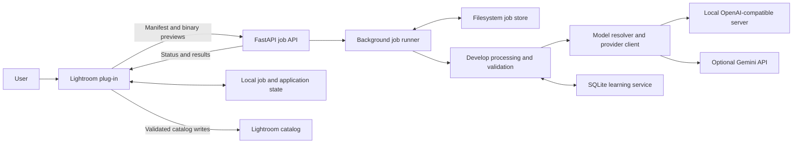
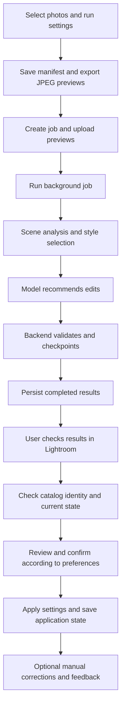

# Architecture, design, and workflow

This document describes the current implementation. Start with the
[README setup](../README.md#setup) for installation and normal use.

## Components and responsibilities

| Component | Responsibility and source |
|---|---|
| Plug-in | Lightroom menus, previews, preferences, job recovery, confirmation, application, and feedback: [plug-in](../AutoDevelopAI.lrplugin/) |
| API | Validate requests and expose Analyze, Develop, jobs, models, and learning operations: [routes](../backend/autodevelop/api/routes/) |
| Runner/store | Bounded background execution, acknowledged previews, checkpoints, and results: [jobs](../backend/autodevelop/jobs/) |
| Inference | Resolve configured providers, analyze scenes, build prompts, parse and validate model responses: [model clients](../backend/autodevelop/model_clients/) |
| Edit validation | Apply deterministic photo-edit policies rather than trusting model output: [validation](../backend/autodevelop/validation/) |
| Styles | Built-in profile policies and automatic selection: [profiles](../backend/autodevelop/profiles/) |
| Learning | SQLite baselines, explicit feedback, similarity retrieval, and aggregate personalization: [learning](../backend/autodevelop/learning/) |

The backend does not operate the Lightroom catalog. The model cannot apply
Lightroom changes directly. Provider keys protect outbound model requests,
not the inbound FastAPI service; see [security boundaries](../SECURITY.md).

## Design decisions

### AI recommends; deterministic code validates; Lightroom applies

Both manual and automatic style requests run scene analysis before Develop
inference. Auto resolves a concrete style; manual selection preserves the
chosen profile. Learning can supply bounded aggregate preferences to prompts.
Model output is parsed into strict contracts and checked against policy.

Backend processing validates slider ranges, geometry, Upright, HDR, and
Denoise decisions. Lightroom performs further response, current-state,
capability, and application checks. Its numeric mapper supports a specific
list of sliders; it does not apply arbitrary model-generated settings.

Source: [model service](../backend/autodevelop/model_clients/service.py),
[Develop processing](../backend/autodevelop/develop_service.py),
[SafetyValidator](../backend/autodevelop/validation/validator.py),
[preparation](../AutoDevelopAI.lrplugin/lib/PreparationService.lua), and
[Develop mapper](../AutoDevelopAI.lrplugin/lib/DevelopSettingsMapper.lua).

### Durable generation is separate from catalog application

The normal Auto Develop menu uses the
[durable submission command](../AutoDevelopAI.lrplugin/lib/DurableDevelopCommand.lua).
It saves a local manifest and active-job pointer, exports previews, creates the
server job, uploads binary JPEGs, and requests background execution. Only after
acknowledgment is it safe to disconnect the Lightroom client and rely on server
processing. The backend and inference provider still need to run.

The background runner processes photos with durable per-photo checkpoints.
Transient failures can stop a job without checkpointing the failing photo;
completed checkpoints are reused on resume. A completed result can contain
per-photo failures, so completion is not a guarantee that every photo succeeded.
Restarted running jobs are marked interrupted and can be resumed explicitly.

The [review command](../AutoDevelopAI.lrplugin/lib/DevelopJobReviewCommand.lua)
checks or recovers the saved job, downloads results, resolves the original
photos, and applies prepared recommendations through the existing confirmation
and catalog-write path. Analyze remains a separate read-only workflow.

### Persistence and saved state

| Location | What is retained |
|---|---|
| Lightroom configured job root | Local manifest, exported previews, downloaded results, and active/application state |
| Backend configured jobs directory | Request manifest, upload acknowledgments, JPEG previews, status, checkpoints, and final result |
| Learning database | Baselines, explicit feedback, metadata, and migrations used for later personalization |

The default plug-in job root is Documents/AutoDevelop AI Jobs. Backend defaults
are `data/jobs/` and `data/autodevelop_learning.sqlite3`. Paths are configurable.
No automatic job-data expiration or application-level encryption is provided.

Backend job files use temporary files and atomic replacement for individual
writes. This does not make all files, server memory, and catalog updates one
transaction. Server execution bookkeeping is process-local; this architecture
does not promise safe concurrent ownership by multiple backend processes sharing
the same job directory.

Source: [JobState](../AutoDevelopAI.lrplugin/lib/JobState.lua),
[JobStore](../backend/autodevelop/jobs/store.py), and
[learning database](../backend/autodevelop/learning/database.py).

### Duplicate and stale-application safeguards

- A reused client job ID with identical manifest data resolves to the existing
  job; different input conflicts. Upload acknowledgments use preview hashes to
  detect different bytes for the same photo.
- The runner avoids scheduling an already-active job within its process and
  skips checkpointed photos on resume. Completed jobs are not regenerated by
  another run request; cancelled jobs cannot be restarted.
- Review checks the submitting catalog, photo identifiers, result membership,
  and captured Develop state before application. It skips photo IDs already
  recorded as applied and prevents ordinary reopening of a closed/applied job.
- After a successful photo application, the plug-in saves its applied photo ID.
  The catalog write happens before this checkpoint. A crash or checkpoint-write
  failure between them leaves an uncertainty window. Stale-state checks help
  protect changed photos but are not a distributed exactly-once guarantee.

Do not delete active-job state or submit a replacement solely because a response
was lost. Recover the original request and inspect warnings first.

## Workflow

The diagram shows a successful path. Unsupported photos, invalid responses,
network failures, cancellation, or application failures can interrupt it.
Confirmation defaults to Always; user preferences can change confirmation
behavior. Model recommendations are not shown as already-applied edits.

## Recovery and rollback limits

| Event | Behavior |
|---|---|
| Lost submission response | The client retains the job identity and local manifest for recovery rather than creating a new batch automatically |
| Backend restart during generation | Previously running jobs become interrupted; review offers explicit resume |
| Running-job cancellation | Cooperative checks stop subsequent work; an in-flight photo request can finish and be checkpointed first |
| Cancelled job | Retained files remain; the normal review flow closes it instead of applying its partial recommendations |
| Per-photo application error | The plug-in attempts restoration of captured settings; summary distinguishes restored and not-restored failures |
| Successful edit later unwanted | There is no dedicated completed-job rollback API; use Lightroom's available recovery tools or a prior backup |

Application uses Lightroom catalog write access and attempts per-photo
restoration on failure. This is not all-or-nothing batch rollback: earlier
successful photos can remain edited if a later photo fails. A restore attempt
can fail too. Never treat cancellation, retained original settings, or a
successful server result as proof of complete catalog recovery.

Source: [application service](../AutoDevelopAI.lrplugin/lib/ApplyService.lua),
[review/application checkpoints](../AutoDevelopAI.lrplugin/lib/DevelopJobReviewCommand.lua),
and [job runner](../backend/autodevelop/jobs/runner.py).

## Compatibility and verification boundaries

The [README compatibility table](../README.md#compatibility) distinguishes
automated Python tests, configured CI targets, existing manual Lightroom checks,
and unverified combinations. No end-to-end compatibility guarantee follows
from a configured model ID, SDK minimum, or passing mocked-provider tests.

See [supported edits](../README.md#supported-edits-and-limitations),
[update instructions](../README.md#updating-an-installation),
[the one-photo walkthrough](../README.md#example-one-travel-photo), and
[learning internals](LEARNING_SYSTEM.md) for related details.
